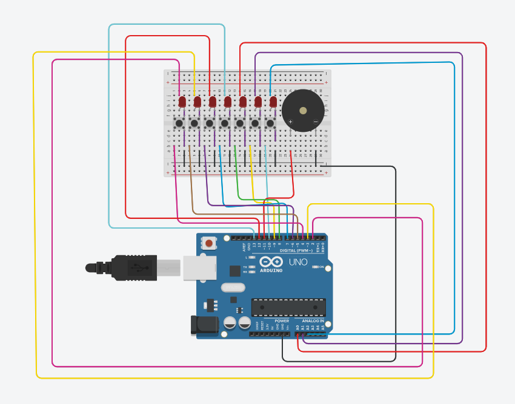

# Arduino Piano: 7 Notes with LED Feedback

A simple electronic piano built with an **Arduino UNO** and simulated in **Tinkercad Circuits**. Each of the 7 push buttons plays one note of the C major scale (Do, Ré, Mi, Fa, Sol, La, Si) on a buzzer, and lights up its own LED while the note is playing.

## Demo

[Watch the demo video](demo.mp4)

> Tinkercad simulation link: https://drive.google.com/file/d/1IFe9E-KWbKZjBa4iJdme-PSWMZgJABx2/view?usp=sharing
## Objective

Design and program a basic musical instrument that:

- Reads 7 push buttons.
- Produces a different tone for each button.
- Gives visual feedback with one LED per note.
- Plays only one note at a time (monophonic).

## Components

| Component | Quantity | Role |
|---|---|---|
| Arduino UNO | 1 | Microcontroller |
| Push buttons | 7 | Piano keys |
| LEDs | 7 | Visual feedback for each note |
| Piezo buzzer | 1 | Sound output |
| Resistors (for LEDs) | 7 | Current limiting |
| Breadboard + jumper wires | n/a | Connections |

## Pin Mapping

| Note | Frequency | Button pin | LED pin |
|---|---|---|---|
| Do (C4) | 262 Hz | D4 | D2 |
| Ré (D4) | 294 Hz | D5 | D3 |
| Mi (E4) | 330 Hz | D6 | D12 |
| Fa (F4) | 349 Hz | D7 | D13 |
| Sol (G4) | 392 Hz | D8 | A0 |
| La (A4) | 440 Hz | D9 | A1 |
| Si (B4) | 494 Hz | D10 | A2 |

The buzzer is connected to **D11**.

## Circuit



Wiring notes:

- Each button connects between its input pin and **GND**. No external resistor is needed because the code uses the Arduino's internal pull-up resistors (`INPUT_PULLUP`).
- Each LED is connected to its output pin through a resistor, with the other leg to GND.
- The buzzer connects between D11 and GND.

## How It Works

1. **Setup:** all button pins are set to `INPUT_PULLUP`, all LED pins to `OUTPUT`, and the buzzer pin to `OUTPUT`.
2. **Loop:** the program scans the 7 buttons in order.
   - With the pull-up resistor, an unpressed button reads `HIGH` and a pressed button reads `LOW`.
   - When a pressed button is found, `tone()` plays the matching frequency on the buzzer and the matching LED turns on.
   - The `break` statement stops the scan after the first pressed button, so only one note plays at a time. If several buttons are pressed together, the lowest note wins.
3. **No button pressed:** `noTone()` silences the buzzer and all LEDs are switched off.

## Code

The full source is in [`src/piano.ino`](src/piano.ino).

```cpp
const int boutons[7] = {4,5,6,7,8,9,10};
const int buzzer = 11;
const int leds[7] = {2, 3, 12, 13, A0, A1, A2};

// Do, Ré, Mi, Fa, Sol, La, Si (Hz)
const int notes[7] = {262, 294, 330, 349, 392, 440, 494};
```

## How to Run

1. Open the Tinkercad simulation (link above), or build the circuit on a breadboard following the pin mapping.
2. Open `src/piano.ino` in the Arduino IDE.
3. Select **Board: Arduino Uno** and the correct port.
4. Click **Upload**.
5. Press the buttons to play notes.

## Possible Improvements

- Add an 8th button for the high Do to complete the octave.
- Allow chords or polyphony with several buzzers.
- Add a potentiometer to change octave or volume.
- Record and replay a melody.
- Add an LCD to display the current note.

## Author

**Your name**, *your school / year*, 2026

## Repository Structure

```
├── README.md
├── demo.mp4
├── src/
│   └── piano.ino
└── images/
    └── circuit.png
```
